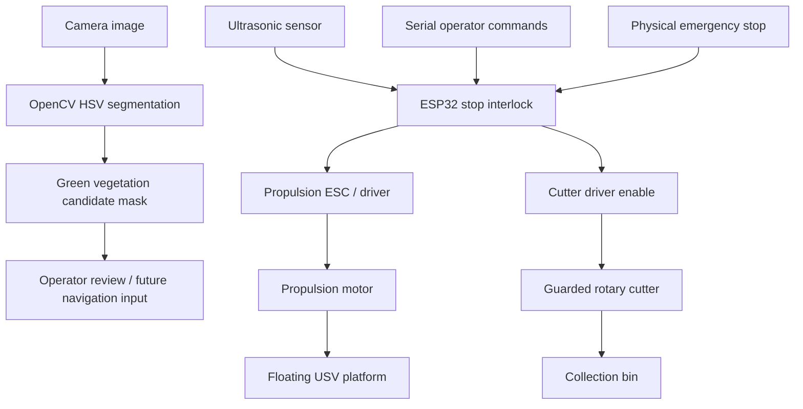

# EcoWave Technical Design

## Architecture

## Modules
- Floating platform: HDPE pontoon/frame and collection bin.
- Controller: ESP32.
- Propulsion: motors controlled through appropriately rated ESCs/drivers.
- Cutter: guarded rotary cutter; disabled by default.
- Obstacle sensing: ultrasonic sensor with simple stop threshold.
- Vision: OpenCV HSV segmentation baseline.
- GPS/waypoint navigation and camera-to-controller automation are future integration tasks, not implemented in this scaffold.

## Limitations
HSV segmentation is sensitive to lighting, reflections, turbidity and other green plants. Ultrasonic sensing can miss angled, soft or submerged obstacles. Generic PWM may not suit every ESC. Software interlocks are not substitutes for a physical emergency stop.

## Verification
1. Run Python tests.
2. Bench-test firmware with motor power disconnected.
3. Verify sensor and stop logic with safe test objects.
4. Test drivers using a current-limited setup.
5. Conduct supervised, low-speed water trials with cutter disabled.
6. Test guarded cutting only in a controlled area with retrieval and emergency procedures.
7. Record actual field measurements before reporting performance.
